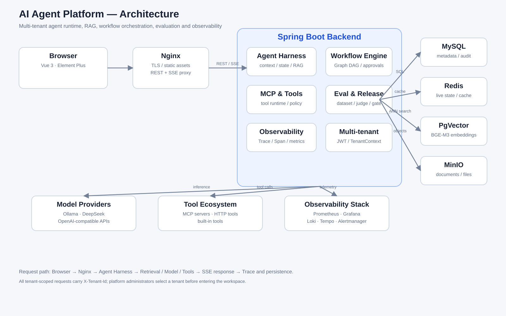
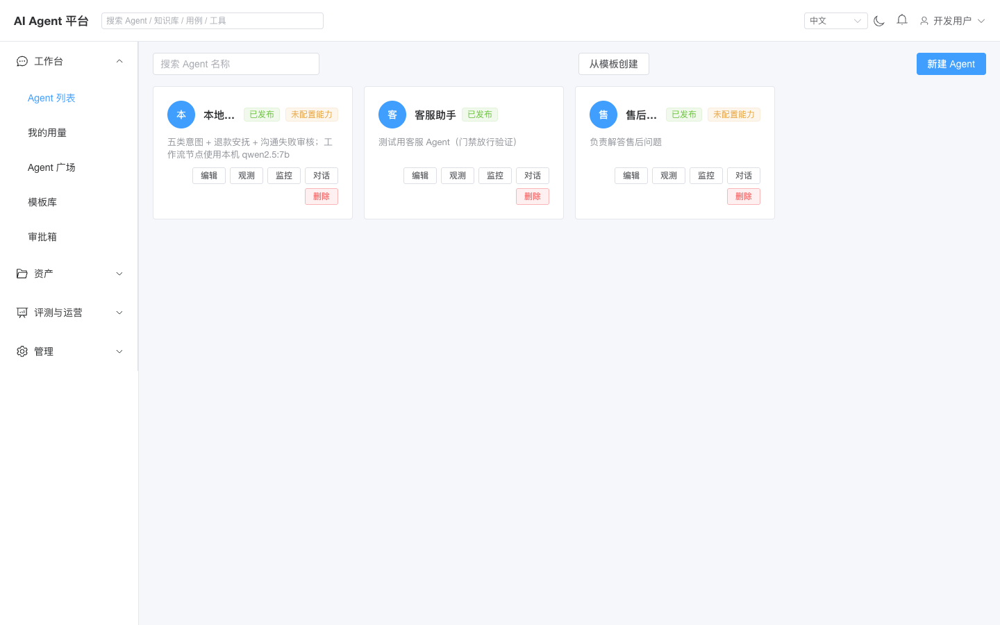
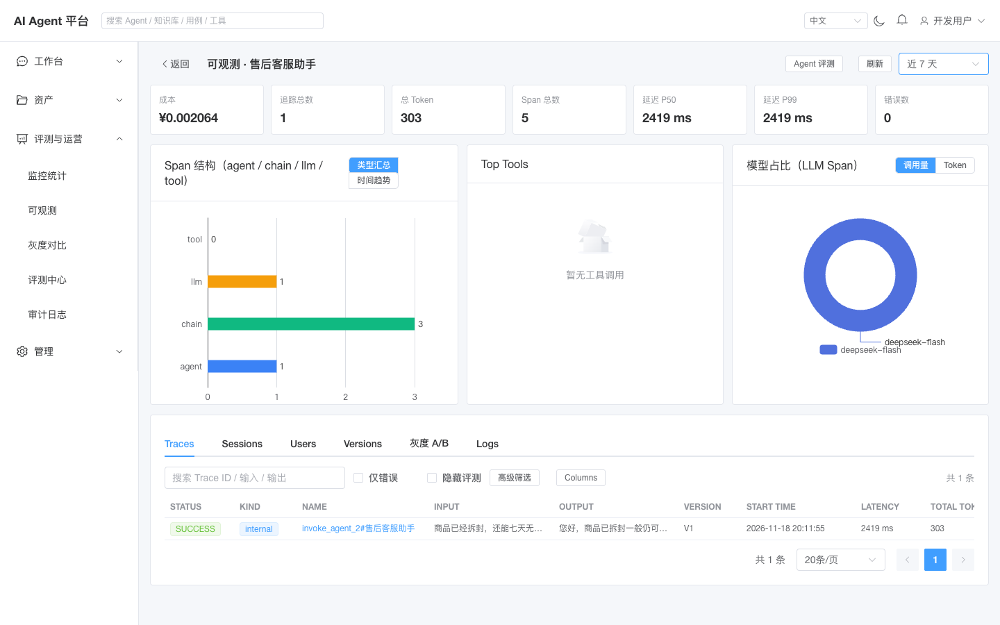
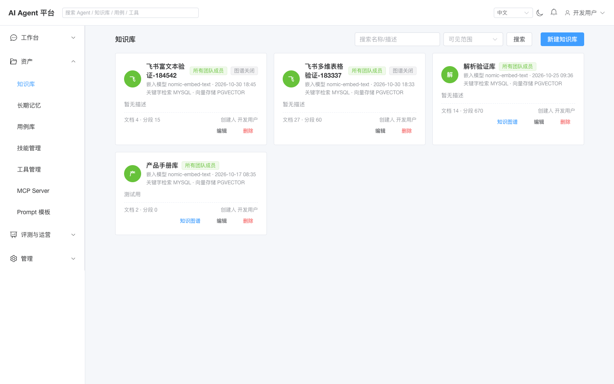

# AI Agent Platform

[](https://github.com/yuanzifang/ai-agent-platform/actions/workflows/ci.yml)
[](https://adoptium.net/)
[](https://spring.io/projects/spring-boot)
[](https://vuejs.org/)
[](LICENSE)

A multi-tenant AI Agent platform for building, evaluating, releasing, and operating production-oriented agents.

It is more than a chat UI: the platform connects agent configuration, context and state, RAG retrieval, tool/MCP execution, graph workflows, evaluation gates, versioned releases, and trace-level observability into one workflow.

[中文 README](README.md) · [Documentation](docs/README.md)

---

## Architecture



The request path is:

```text
Browser → Nginx → Spring Boot backend
        → Agent harness / context / RAG
        → Model provider or MCP/HTTP tools
        → SSE response + messages/checkpoints
        → Trace/Span + usage/cost/observability
```

The backend is modular rather than a single chat controller:

- **Agent runtime** — versioned agent configuration, context assembly, model routing, fallback, tool execution and SSE streaming.
- **Workflow engine** — graph-based orchestration with conditions, state, approvals, retries and resumable runs.
- **Knowledge/RAG** — document ingestion, cleaning, sectioning, chunking, embeddings, hybrid retrieval, permissions and citations.
- **Evaluation and release** — datasets, LLM judge, pass thresholds, release gate and version rollback.
- **Observability** — one trace per invocation, a span tree for retrieval/LLM/tool/sub-agent steps, token and cost accounting.
- **Multi-tenancy and security** — JWT tenant context, tenant-scoped persistence, platform-admin tenant switching, write-tool approval and prompt-injection checks.

---

## Key Capabilities

### Agent runtime

Agents are configured, versioned and published rather than hard-coded:

- model and fallback-model selection
- system prompt, opening statement and variables
- knowledge-base bindings and retrieval settings
- tools, skills and sub-agents
- conversation history, long-term memory and context-window fitting
- SSE streaming with resumable output snapshots

The platform records the execution path so a failed answer can be traced back to retrieval, prompt, model or tool behavior.

### Graph workflows

Workflows are stored as a JSON graph:

- `START`
- `LLM`
- `AGENT`
- `KNOWLEDGE`
- `CONDITION`
- `STATE`
- `APPROVAL`
- `END`

Runs persist node-level execution state and can pause for human approval. Approval timeout, resume and retry paths are handled by the workflow runtime and schedulers.

### RAG knowledge base

The knowledge pipeline covers:

```text
upload → parse → clean → section classify → chunk → embed
       → MySQL metadata + PgVector vectors
       → hybrid retrieval → permission filter → rerank → cited answer
```

The platform supports tenant/member/private visibility, keyword fallback, vector search and citation metadata.

### Evaluation and release gate

Evaluation is a regression workflow, not a single demo question:

1. build or import a dataset
2. run the agent against test cases
3. score with an LLM judge
4. summarize pass rate and failure categories
5. block publishing below the configured threshold
6. keep versions so a release can be rolled back

### Trace and Span observability

One user invocation produces one trace, and each execution step produces a span:

```text
Trace: one agent invocation
└── Span: agent
    ├── Span: retrieval
    ├── Span: llm
    ├── Span: tool
    │   └── Span: chain (sub-agent)
    └── Span: context / persistence step
```

Each span stores `traceId`, `spanId`, `parentSpanId`, type, status, start/end time, duration, model/tool name, tokens and JSON attributes. Trace writes use a bounded asynchronous queue so observability does not back-pressure the conversation path. The UI exposes trace search, span structure, token/cost, latency percentiles, model share and tool usage.

### Security and tenant isolation

- JWT-based authentication with tenant and role claims.
- `TenantContext` plus MyBatis tenant-line enforcement.
- Platform administrators explicitly enter a tenant before using tenant-scoped pages.
- Write tools can be blocked or routed through human approval.
- Prompt-injection inspection includes normalization, zero-width removal and compact-pattern matching.
- Tool network policy and outbound host checks reduce SSRF risk.

---

## Screenshots

### Agent workspace



### Trace, span and usage observability



### Knowledge bases and RAG assets



---

## Quick Start

### Docker Compose

Prerequisites: Docker Engine / Docker Desktop and Docker Compose v2.

```bash
git clone https://github.com/yuanzifang/ai-agent-platform.git
cd ai-agent-platform

# Generates .env.docker with random secrets, then builds and starts the stack
scripts/docker-up.sh
```

Open `http://localhost:${HTTP_PORT:-80}` after startup.

Configuration lives in `.env.docker` (ignored by git). At minimum, set:

```text
DEEPSEEK_API_KEY=...
PLATFORM_ADMIN_PASSWORD=...
```

The first startup creates the database schema and seed data. `DEV_PASSWORD` is only activated for a development/demo deployment; do not use the built-in demo password in a public environment.

### Host Ollama

If the host already has `bge-m3` and an OpenAI-compatible Ollama endpoint:

```bash
docker compose -f docker-compose.yml \
  -f docker-compose.external-minio.yml \
  -f docker-compose.external-ollama.yml up -d
```

The backend then uses `host.docker.internal:11434` for `OLLAMA_ENDPOINT` and `EMBEDDING_ENDPOINT`.

### Local development

```bash
# backend
cd backend
mvn spring-boot:run

# frontend
cd frontend
npm install
npm run dev
```

See [docs/README.md](docs/README.md) and [README.md](README.md) for the full local setup and operational notes.

---

## Project Layout

```text
backend/            Spring Boot 3 / Spring AI application
frontend/           Vue 3 + TypeScript + Vite + Element Plus
runtime/            alert-relay service
deploy/             Docker Compose, Helm, monitoring and HA assets
scripts/            build, backup, restore, security and benchmark helpers
docs/               architecture, operations, evaluation and acceptance notes
docs/assets/readme/ README architecture diagram and screenshots
```

---

## Testing and CI

```bash
# backend unit/integration tests
cd backend && mvn test

# frontend type check and build
cd frontend && npm ci && npm run build

# browser E2E
cd frontend && npm run test:e2e
```

The GitHub Actions pipeline covers:

- gitleaks secret scanning
- dependency and image vulnerability scanning with Trivy
- backend build and tests
- frontend build and type checks
- Playwright E2E
- image SBOM generation
- CodeQL and security workflows

Latest CI status: [GitHub Actions](https://github.com/yuanzifang/ai-agent-platform/actions/workflows/ci.yml)

---

## Deployment

- `docker-compose.yml` — single-host Docker Compose stack
- `deploy/k8s/` — Helm/Kubernetes assets
- `deploy/observability/` — Prometheus, Grafana, Loki and Tempo configuration
- `deploy/systemd/` — backup and maintenance timers

The Compose stack includes MySQL, Redis, PgVector, MinIO (or an external MinIO), backend, frontend, Ollama (or an external Ollama), Prometheus, Grafana, Alertmanager and alert-relay.

---

## Status and Boundaries

This repository is a working POC and engineering showcase, not a claim of production acceptance.

- Demo metrics are shown with their actual scope and test count.
- Do not interpret sample data or a single successful answer as general accuracy.
- Production deployment still requires domain security review, capacity planning, backup/restore drills and model/provider acceptance.
- No “100% accuracy” or “production-ready” claim is made.

---

## License

Apache License 2.0. See [LICENSE](LICENSE) and [NOTICE](NOTICE).
